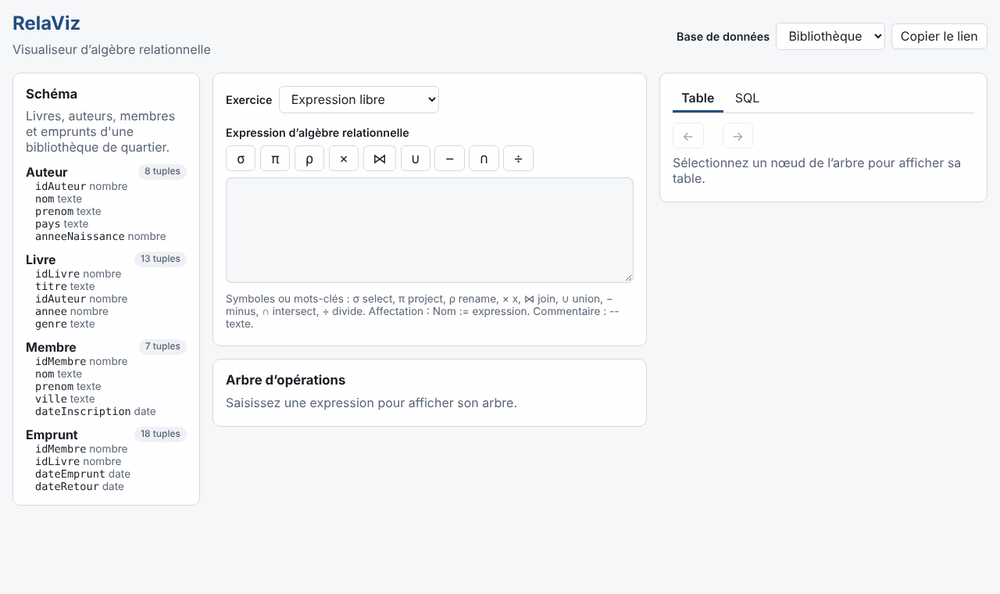
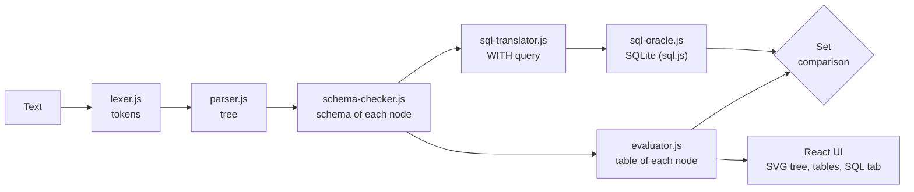

# RelaViz

[](https://github.com/Chakib-Selhi/Relaviz/actions/workflows/ci.yml)
[](LICENSE)

[Français](README.md) · **English**

RelaViz runs a relational algebra expression, draws it as an operation tree, shows the table produced at every step and gives the equivalent SQL query, checked against SQLite directly in the browser.

**[Try RelaViz online](https://chakib-selhi.github.io/Relaviz/)** (the interface is in French)



## The problem

In database courses, relational algebra is mostly practiced on paper: students write an expression without being able to check its result or see which join or selection goes wrong. The link between algebra and SQL stays abstract.

RelaViz makes every step visible:

- **Clickable operation tree**: each node shows its tuple count; clicking it shows its table.
- **Step-by-step mode**: walks the tree from the leaves to the root, in execution order.
- **Clear error messages** with line and column: syntax, unknown attribute (with a suggestion), ambiguous reference, incompatible relations, type mismatch.
- **Verified SQL**: the translated query runs in SQLite (sql.js) and is compared with the engine's result.
- **15 built-in exercises** on 3 sample databases, with answer checking.
- **Sharing by URL**: the database, expression and exercise are encoded in the link.

## Syntax

Every operator has a symbol and an ASCII keyword. Parameters always go in square brackets.

| Operator       | Symbol                         | ASCII                                     |
| -------------- | ------------------------------ | ----------------------------------------- |
| Selection      | `σ[annee > 2020](Livre)`       | `select[annee > 2020](Livre)`             |
| Projection     | `π[titre, nom](R)`             | `project[titre, nom](R)`                  |
| Rename         | `ρ[L(a, b)](R)`, `ρ[a → x](R)` | `rename[L(a, b)](R)`, `rename[a -> x](R)` |
| Product, joins | `R × S`, `R ⋈ S`, `R ⋈[c] S`   | `R x S`, `R join S`, `R join[c] S`        |
| Set operations | `R ∪ S`, `R − S`, `R ∩ S`      | `R union S`, `R minus S`, `R intersect S` |
| Division       | `R ÷ S`                        | `R divide S`                              |

```text
-- Members who borrowed every book by Aline Morel
LivresMorel := π[idLivre](σ[nom = 'Morel' and prenom = 'Aline'](Auteur) ⋈ Livre)
π[nom, prenom]((π[idMembre, idLivre](Emprunt) ÷ LivresMorel) ⋈ Membre)
```

The full grammar (EBNF, precedence, error messages) is in [docs/grammar.md](docs/grammar.md) and the semantics (schemas, `NULL`, types) in [docs/semantics.md](docs/semantics.md). Both documents are in French.

## Architecture



- **Engine** (`src/engine/`): plain JavaScript with no React or DOM dependency. ESLint and TypeScript in JSDoc mode, configured without the `dom` library, enforce this rule.
- **Interface** (`src/ui/`): React + Vite. The tree is drawn in SVG with a hand-written layout.
- **No backend**: everything runs in the browser; sql.js is loaded only when the SQL tab is opened.

## The parser

The parser is hand-written, without a parser generator (no PEG.js, ANTLR or Nearley):

1. **Lexer**: scans the text character by character with a single index, so every token keeps its exact position. It applies the longest-match rule (`<=` before `<`, `->` before `-`) and accepts each operator in ASCII and Unicode.
2. **Recursive descent**: each EBNF rule is a method. Each precedence level is a `while` loop, which builds left-associative trees without left recursion.
3. **No backtracking**: one token of lookahead is enough, except to detect `Name :=` (two tokens) and the rename forms, which are left-factored. Parsing is therefore linear.
4. **Precise errors**: at each decision point the parser knows what it expected, which gives messages such as "« ] » attendu pour fermer la condition de σ, trouvé « ( »".
5. **Step order for free**: nodes get their id after their children, which directly gives the postfix order.

## Quality

- 498 tests (Vitest, Testing Library); engine coverage above 99 % of lines, with a blocking 85 % threshold.
- **Agreement with SQLite**: 64 expressions and the 15 exercise solutions run through the engine and through SQLite, step by step, with identical results.
- Continuous integration on Node 22 and 24: ESLint, Prettier, JSDoc types, tests and build; automatic deployment to GitHub Pages.

## Running the project

Requirements: Node.js 22.12 or later.

```bash
git clone https://github.com/Chakib-Selhi/Relaviz.git
cd Relaviz
npm install
npm run dev
```

| Command         | Purpose                                                   |
| --------------- | --------------------------------------------------------- |
| `npm run dev`   | development server                                        |
| `npm test`      | tests                                                     |
| `npm run check` | lint, formatting, types and tests with coverage, as in CI |
| `npm run build` | production build in `dist/`                               |

## Known limitations

- Set semantics only: duplicates are always removed (no bag semantics).
- No outer joins or aggregation yet (planned for V1.1), and no import of personal tables.
- No arithmetic in conditions (`prix * 2 > 10`).
- Designed for small teaching databases (a few thousand tuples per relation at most).
- The interface is French-only for now; its texts are centralized for translation.

## License

[MIT](LICENSE) © 2026 Chakib Selhi. The sample data is made up for the project.
