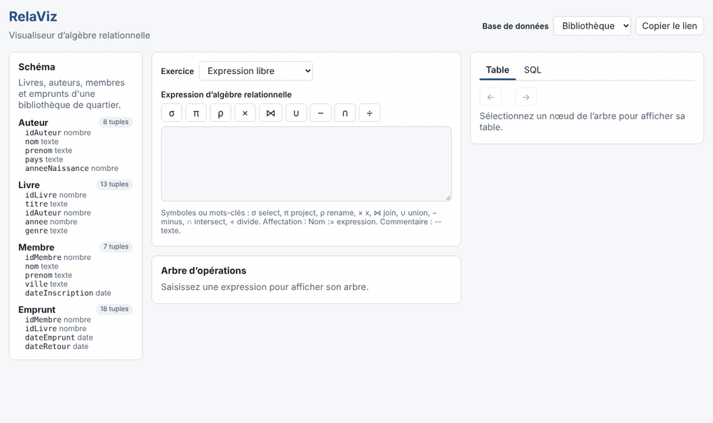
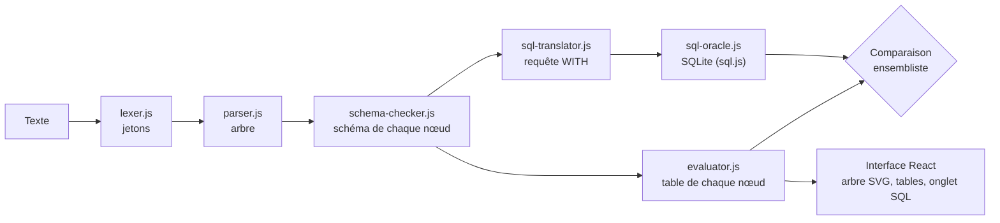

# RelaViz

[](https://github.com/Chakib-Selhi/Relaviz/actions/workflows/ci.yml)
[](LICENSE)

**Français** · [English](README.en.md)

RelaViz exécute une expression d'algèbre relationnelle, l'affiche sous forme d'arbre d'opérations, montre la table produite à chaque étape et donne la requête SQL équivalente, vérifiée avec SQLite directement dans le navigateur.

**[Essayer RelaViz en ligne](https://chakib-selhi.github.io/Relaviz/)**



## Le problème

En cours de bases de données, l'algèbre relationnelle se pratique surtout sur papier : on écrit une expression sans pouvoir vérifier son résultat, ni voir à quelle étape une jointure ou une sélection se trompe. Le lien entre l'algèbre et SQL reste abstrait.

RelaViz rend chaque étape visible :

- **Arbre d'opérations cliquable** : chaque nœud affiche son nombre de tuples, un clic montre sa table.
- **Mode pas à pas** : parcours de l'arbre des feuilles vers la racine, dans l'ordre d'exécution.
- **Erreurs expliquées en français**, avec ligne et colonne : syntaxe, attribut inconnu (avec suggestion), référence ambiguë, relations incompatibles, comparaison de types différents.
- **SQL équivalent vérifié** : la requête est exécutée par SQLite (sql.js) et comparée au résultat du moteur.
- **15 exercices préchargés** sur 3 bases d'exemple, avec vérification de la réponse.
- **Partage par URL** : la base, l'expression et l'exercice sont encodés dans le lien.

## Syntaxe

Chaque opérateur s'écrit avec son symbole ou un mot-clé ASCII. Les paramètres sont toujours entre crochets.

| Opérateur          | Symbole                        | ASCII                                     |
| ------------------ | ------------------------------ | ----------------------------------------- |
| Sélection          | `σ[annee > 2020](Livre)`       | `select[annee > 2020](Livre)`             |
| Projection         | `π[titre, nom](R)`             | `project[titre, nom](R)`                  |
| Renommage          | `ρ[L(a, b)](R)`, `ρ[a → x](R)` | `rename[L(a, b)](R)`, `rename[a -> x](R)` |
| Produit, jointures | `R × S`, `R ⋈ S`, `R ⋈[c] S`   | `R x S`, `R join S`, `R join[c] S`        |
| Ensembles          | `R ∪ S`, `R − S`, `R ∩ S`      | `R union S`, `R minus S`, `R intersect S` |
| Division           | `R ÷ S`                        | `R divide S`                              |

```text
-- Membres qui ont emprunté tous les livres d'Aline Morel
LivresMorel := π[idLivre](σ[nom = 'Morel' and prenom = 'Aline'](Auteur) ⋈ Livre)
π[nom, prenom]((π[idMembre, idLivre](Emprunt) ÷ LivresMorel) ⋈ Membre)
```

La grammaire complète (EBNF, priorités, messages d'erreur) est dans [docs/grammar.md](docs/grammar.md) et la sémantique (schémas, `NULL`, types) dans [docs/semantics.md](docs/semantics.md).

## Architecture



- **Moteur** (`src/engine/`) : JavaScript pur, sans React ni DOM. Cette règle est vérifiée par ESLint et par TypeScript en mode JSDoc, configuré sans la bibliothèque `dom`.
- **Interface** (`src/ui/`) : React + Vite. L'arbre est dessiné en SVG avec un placement fait maison.
- **Aucun backend** : tout s'exécute dans le navigateur ; sql.js n'est chargé qu'à l'ouverture de l'onglet SQL.

Détails dans [docs/architecture.md](docs/architecture.md).

## L'analyseur

L'analyseur est écrit à la main, sans générateur (pas de PEG.js, ANTLR ou Nearley) :

1. **Analyseur lexical** : il parcourt le texte caractère par caractère avec un seul indice, ce qui donne à chaque jeton sa position exacte. Il applique la règle du plus long préfixe (`<=` avant `<`, `->` avant `-`) et reconnaît chaque opérateur en ASCII et en Unicode.
2. **Descente récursive** : chaque règle EBNF est une méthode. Chaque niveau de priorité est une boucle `while`, ce qui construit des arbres associatifs à gauche sans récursion à gauche.
3. **Sans retour arrière** : un jeton d'avance suffit, sauf pour reconnaître `Nom :=` (deux jetons) et le renommage, factorisé à gauche. L'analyse est donc linéaire.
4. **Erreurs précises** : à chaque point de décision, l'analyseur sait ce qu'il attendait, d'où des messages comme « « ] » attendu pour fermer la condition de σ, trouvé « ( » ».
5. **Ordre du pas à pas** : les nœuds reçoivent leur identifiant après leurs enfants, ce qui donne directement l'ordre postfixe.

## Qualité

- 498 tests (Vitest, Testing Library) ; couverture du moteur supérieure à 99 % des lignes, avec un seuil bloquant de 85 %.
- **Concordance avec SQLite** : 64 expressions et les 15 solutions d'exercices sont exécutées par le moteur et par SQLite, étape par étape, avec des résultats identiques.
- Intégration continue sur Node 22 et 24 : ESLint, Prettier, types JSDoc, tests et build ; déploiement automatique sur GitHub Pages.

## Lancer le projet

Prérequis : Node.js 22.12 ou plus récent.

```bash
git clone https://github.com/Chakib-Selhi/Relaviz.git
cd Relaviz
npm install
npm run dev
```

| Commande        | Rôle                                                         |
| --------------- | ------------------------------------------------------------ |
| `npm run dev`   | serveur de développement                                     |
| `npm test`      | tests                                                        |
| `npm run check` | lint, formatage, types et tests avec couverture, comme en CI |
| `npm run build` | build de production dans `dist/`                             |

## Limites connues

- Sémantique d'ensemble uniquement : les doublons sont toujours éliminés (pas de multiensembles).
- Pas encore de jointures externes ni d'agrégation (prévues en V1.1), ni d'import de tables personnelles.
- Pas d'arithmétique dans les conditions (`prix * 2 > 10`).
- Conçu pour de petites bases pédagogiques (moins de quelques milliers de tuples par relation).
- Interface en français seulement pour l'instant ; les textes sont centralisés pour une traduction.

## Licence

[MIT](LICENSE) © 2026 Chakib Selhi. Les données des bases d'exemple sont inventées pour le projet.
