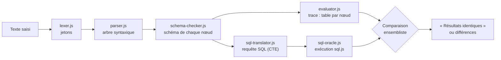
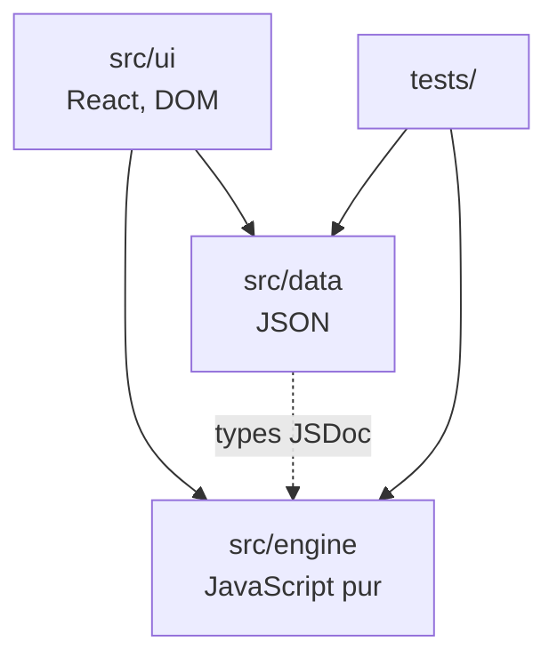

# Architecture de RelaViz

RelaViz est une application entièrement côté client. Le code se divise en deux parties indépendantes : un **moteur** en JavaScript pur, qui analyse, vérifie, évalue et traduit les expressions, et une **interface** React qui l'affiche. Ce document décrit le découpage, les règles de dépendance et la stratégie de test. Les exigences sont dans le [PRD](PRD.md), le langage d'entrée dans la [grammaire](grammar.md) et le sens de chaque opérateur dans la [sémantique](semantics.md).

## Pipeline du moteur



L'arbre produit par l'analyseur est la seule représentation partagée. L'évaluateur et le traducteur SQL le parcourent chacun de leur côté ; sql.js sert ensuite d'oracle pour confirmer que les deux chemins donnent le même résultat.

## Modules

| Module                         | Entrée                    | Sortie                                      | Phase |
| ------------------------------ | ------------------------- | ------------------------------------------- | ----- |
| `src/engine/types.js`          |                           | types JSDoc du modèle de données            | 0     |
| `src/engine/errors.js`         | code + position           | erreur positionnée, messages en français    | 1     |
| `src/engine/lexer.js`          | texte                     | jetons positionnés, ou erreur lexicale      | 1     |
| `src/engine/parser.js`         | texte                     | programme (affectations + arbre), ou erreur | 1     |
| `src/engine/format.js`         | arbre ou condition        | étiquettes et notation compacte de l'arbre  | 1     |
| `src/engine/schema-checker.js` | arbre + schéma de la base | schéma de sortie de chaque nœud, ou erreurs | 2     |
| `src/engine/evaluator.js`      | arbre vérifié + base      | trace : une relation par nœud (`TraceStep`) | 2     |
| `src/engine/index.js`          | texte + base              | `analyze` : analyse, vérification, trace    | 2     |
| `src/engine/sql-translator.js` | arbre vérifié             | requête SQL lisible en CTE `WITH`           | 3     |
| `src/engine/sql-oracle.js`     | base + requête SQL        | relation calculée par SQLite (sql.js)       | 3     |
| `src/data/`                    |                           | bases d'exemple et exercices                | 0, 5  |
| `src/ui/`                      | moteur + données          | composants React                            | 4     |

Chaque étape du moteur est une fonction pure : même entrée, même sortie, sans état global. À l'intérieur du moteur, une erreur est une `RelaVizError` levée au point où elle est détectée ; les fonctions publiques (`parse`, puis celles des phases suivantes) la retournent comme une valeur (`ErrorInfo` : code, message, ligne, colonne, `span`). L'interface n'a donc jamais d'exception à intercepter et peut afficher l'erreur à chaque frappe.

`errors.js` et `format.js` complètent les six modules du PRD : le premier partage le type d'erreur et le catalogue de messages entre tous les modules, le second sert aux tests, aux messages et aux étiquettes de l'arbre dans l'interface.

## Règles de dépendance



- `src/engine` et `src/data` ne dépendent **ni de React, ni du DOM, ni de `src/ui`**. Le moteur reste ainsi testable sous Node et réutilisable dans un autre contexte (ligne de commande, autre interface).
- Cette règle est vérifiée automatiquement à deux niveaux :
  - **ESLint** (`eslint.config.js`) refuse dans ces dossiers les imports de `react`, `react-dom` ou `ui/`, et les globals du navigateur (`window`, `document`...).
  - **TypeScript en mode JSDoc** (`jsconfig.json`) vérifie ces dossiers avec la seule bibliothèque `ES2022`, sans `dom` : toute API du navigateur y est une erreur de type.
- `sql.js` est la seule dépendance externe du moteur. Il est chargé de façon différée, à l'ouverture de l'onglet SQL, pour ne pas alourdir le premier affichage.

## Arborescence

```text
relaviz/
├── .github/workflows/ci.yml   intégration continue
├── docs/                      PRD, grammaire, architecture
├── public/                    fichiers statiques (favicon)
├── src/
│   ├── engine/                moteur : analyse, vérification, évaluation, SQL
│   ├── data/                  bases d'exemple (JSON) et exercices
│   ├── ui/                    composants React
│   └── main.jsx               point d'entrée de Vite
└── tests/                     tests Vitest, même découpage que src/
```

Les tests sont regroupés dans `tests/` plutôt qu'à côté des sources, pour que `src/engine` ne contienne que le code du moteur et que la couverture se mesure sans filtre supplémentaire.

## Stratégie de test

| Niveau               | Contenu                                                                                                         | Outil                 |
| -------------------- | --------------------------------------------------------------------------------------------------------------- | --------------------- |
| Données              | arité, types, dates ISO, absence de doublons, clés étrangères implicites                                        | Vitest                |
| Unitaire, par module | jetons, priorités, erreurs positionnées, schémas de sortie, chaque opérateur, traduction SQL                    | Vitest                |
| Croisé moteur et SQL | chaque expression de la suite est exécutée par l'évaluateur **et** par sql.js ; résultats égaux comme ensembles | Vitest + sql.js       |
| Couverture           | 85 % minimum sur `src/engine` (instructions, branches, fonctions, lignes), bloquant en CI                       | `@vitest/coverage-v8` |

## Outillage

| Outil              | Rôle                                                                     |
| ------------------ | ------------------------------------------------------------------------ |
| Vite               | serveur de développement et build de production                          |
| Vitest             | tests, dans un environnement Node (le moteur n'a pas besoin du DOM)      |
| ESLint             | qualité du code et isolement du moteur                                   |
| Prettier           | formatage uniforme du code et de la documentation                        |
| TypeScript (`tsc`) | vérification des types JSDoc du moteur, sans écrire de TypeScript        |
| GitHub Actions     | lint, formatage, types, tests avec couverture et build sur Node 22 et 24 |
